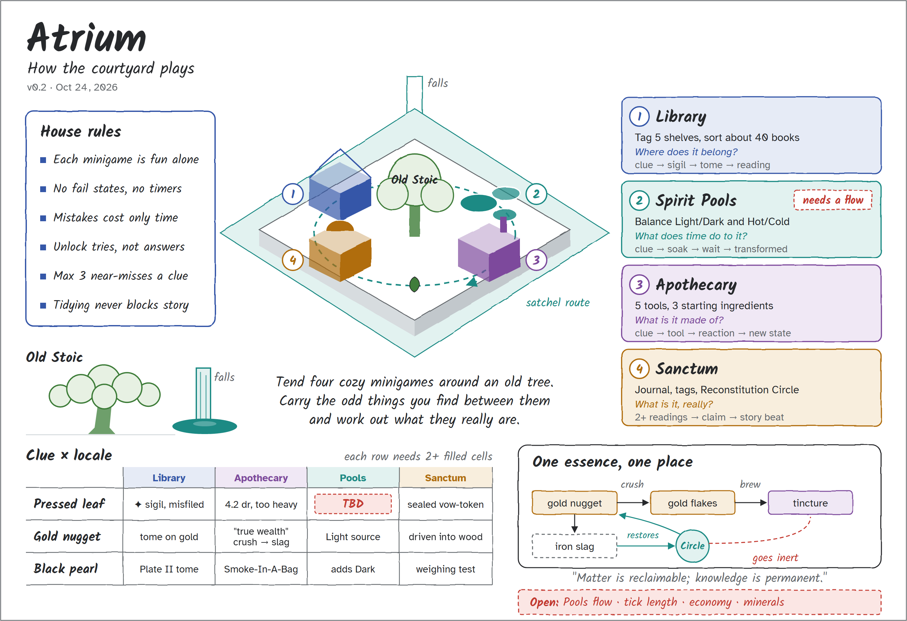

# Atrium

*A cozy puzzle game about tending a forgotten courtyard, and slowly working out the secrets that turn up in it.*

**Genre:** Cozy · Puzzle / Deduction  **Engine:** C# / .NET 10 core; Godot 4.7 (.NET) front end in progress  **Status:** first playable: Chapter One (terminal)



*The overview sheet, as a rough mockup. Design sheets live in [docs/design/](docs/design/).*

This folder holds the design brief ([AGENTS.md](AGENTS.md)) and the playable builds. The game is an engine-agnostic C# core with a standalone terminal front end (iteration 1), which has all four minigames, five clue-objects and 42 tomes. This folder is also the Godot 4.7 .NET project the game is moving to. So far that project imports the art and loads the core; it has no gameplay scenes yet. An earlier 3D front end, the "lantern-lit diorama" (iteration 2, on raylib), is kept on the `standalone-diorama` branch. See [Play it](#play-it) and [What exists today](#what-exists-today).

> Proper nouns below (Stairfall, the Slowsilver, Old Stoic, the Stillkeepers and so on) come from the prototypes and are placeholders until the designer approves them.

---

## Play it

You need the [.NET 10 SDK or newer](https://dotnet.microsoft.com/download). From this folder, the terminal game:

```bash
dotnet run --project src/Atrium.Terminal
```

The game opens full-screen in your terminal. Every option is a single keypress. `Esc` or `X` goes back, and
`,` / `.` turn pages. Windows Terminal, or any terminal with 24-bit colour, looks best. Make the window
about 100×40 or larger. Saves go to `%APPDATA%\Atrium\saves` automatically.

To check designer content after editing anything in [content/](content/):

```bash
dotnet run --project src/Atrium.Terminal -- --validate
```

To run the tests, including a full scripted playthrough of Chapter One:

```bash
dotnet test tests/Atrium.Core.Tests
```

Name the test project: a bare `dotnet test` in this folder now stops with an error, because the folder holds both
`Atrium.slnx` and the Godot project's `AtriumGodot.csproj`.

### The Godot project

This folder is also a Godot 4.7 project, written in C# only (no GDScript). So far it covers the assets and the
core: it loads the game's content through `Atrium.Core`, imports every model in [art/models/](art/models/) and
every texture in [art/textures/](art/textures/), and shows them in a viewer. There are no gameplay scenes yet; to
play, use the terminal game.

You need the **.NET** build of Godot 4.7.2 (the standard build can't run C#) and the .NET 10 SDK. Open
`project.godot` in the Godot 4.7.2 .NET editor and press F5. The editor builds the C# itself, through
`Atrium.slnx`. The first time you open the project, Godot imports every model and texture, which takes a little
while.

The viewer shows one model at a time, lit and framed, with a list of its parts and markers, its size, and a line
summing up the content the core loaded.

| Key | Does |
|---|---|
| `←` / `→` (or `Page Up` / `Page Down`) | previous / next model, or texture |
| `↑` / `↓` | step through a kit's pieces one at a time, and back to the whole model |
| `M` | show or hide the markers (orange spheres with their names) |
| `Tab` or `T` | switch between models and textures; each texture is shown beside a 2×2 repeat, to check that it tiles |
| `R` | reset the camera |
| left-drag, wheel | orbit, zoom |
| `Esc` | quit |

From the command line (Git Bash, from this folder), build first; only the editor builds on its own. Set `G` to
wherever Godot is installed:

```bash
G="/c/Program Files/Godot/Godot_v4.7.2-stable_mono_win64/Godot_v4.7.2-stable_mono_win64_console.exe"
dotnet build Atrium.slnx
"$G" --path .                                                            # the viewer
"$G" --headless --path . --scene res://godot/Check/Check.tscn; echo $?   # the check
```

The check runs without a window. It loads the content through the core, plays a session and round-trips its
save, checks that every model arrives node for node and colour for colour as it was exported, and checks that
every texture imported with the right settings. It prints a report ending in `PASS` or `FAIL` and exits 0 (pass),
1 (failures) or 2 (the check itself broke). Today it passes with 2 warnings, both about the lamp colours in the
city and wall kits. [docs/ARCHITECTURE.md](docs/ARCHITECTURE.md#the-godot-project) has the other commands and
what each part of the project does.

The raylib diorama (iteration 2) isn't on this branch. It's kept on `standalone-diorama` as a reference:

```bash
git switch standalone-diorama
dotnet run --project src/Atrium.Diorama
```

Its art, audio and "juice" choices are in [docs/design/iteration-2-diorama.md](docs/design/iteration-2-diorama.md).

For writing content, see [docs/CONTENT_GUIDE.md](docs/CONTENT_GUIDE.md). For how it's built, including the
Godot project, see [docs/ARCHITECTURE.md](docs/ARCHITECTURE.md). For what this iteration decided and what
it left open, see [docs/design/iteration-1.md](docs/design/iteration-1.md).

---

## The premise

> *Tucked away inside a sprawling stone city, at the edge of a broken city waterway, lies a forgotten atrium. Small shops, their proprietors barely able to keep their doors open, surround an old, towering tree that drinks from the accidental waterfall, its branches covering the soft pools at its base and casting the atrium with a calm, stoic coziness.*

You are the Keeper of the Atrium, a mossy courtyard on the canyon floor of Stairfall. Stairfall is built down a cliff face in tiers: the Crown, the Gallery, the Ribs, the Hem, and at the bottom, the Atrium. An old tree, Old Stoic, leans out over turquoise water, and a tall, lazy waterfall, the Slowsilver, comes down from the high tiers. The tree is big, old, serene and unchanging; it isn't a progress tracker. A centuries-old charter sets the Keeper's duties: *"keep the stacks in order, the pools in health, the lamps in oil, and the stillness in good repair."*

Four struggling institutions sit around the tree, and each is a small, complete minigame. Over time, odd clue-objects turn up: a leaf filed on the wrong shelf, a gold nugget, a black pearl. Each locale's mechanics show you something different about an object, so you carry it from one to the next. Putting those findings together is the mystery.

There are no timers, no game-overs, no permanent loss and no urgency. The story invites you in and never hurries you.

**Inspirations:** *Strange Horticulture* and *Strange Antiquities* (deductive identification, taxonomy tagging), *Librarian: Tidy Up the Arcane Library!* (sorting as play), *Potion Craft* (grounded alchemy), *Fish Tycoon* (slow real-time breeding and tank-keeping).

---

## Design pillar: minigames first

Every locale has to be a good game even if you ignore the mystery. The story uses each minigame's own mechanics to reveal things about a clue-object, and never replaces a minigame with a menu built only for inspecting clues.

Mistakes are meant to make you curious. A wrong answer costs time and never items, it points you back to your own notes, and the truth can always be proven from evidence you can't permanently miss.

---

## Shared systems

| System | What it is |
|---|---|
| **Satchel** | What you carry. Clue-objects, altered objects, one checked-out Library book, and Sanctum outputs all travel between locales in the satchel. |
| **Event Log** | An automatic, permanent record of every result you observe: readings, reactions, near-misses. |
| **Player Journal** | Kept at the Sanctum, with a copy you can open anywhere. You tag findings in it, and it collects your freehand Library notes. Nothing written in it is ever lost. |
| **World-clock** | One slow, pausable real-time clock that drives everything time-based, mainly the Spirit Pools. It never creates pressure. |

---

## The four locales

### The Library: sorting and lore
A tidy, hands-on organisation puzzle. The Milanote board plans it like this:

1. **Start:** 5 empty shelves, a stack of 5 genre tags and a pile of about 40 books.
2. **Tag the shelves.** Place a genre tag on a shelf (Horticulture, History, Husbandry, Mysticism or Mathematics), and the shelf lights up in that genre's colour.
3. **Shelve the books.** Each book has a title, a colour-coded cover, an author, a publication year and two pages of content. Put it on the right shelf and the shelf pulses with light.
4. **Read and annotate.** Draw on pages freehand to take notes and link clue-objects to people. The notes also appear in the Player Journal.
5. **Check out a book.** Carry one book in your satchel for reference in other locales.

The prototypes use a different shelving model, and the choice is still open (see [What exists today](#what-exists-today)). The Library holds most of the game's lore and plants the threads later puzzles depend on. For a clue, it answers classification and cross-reference questions: where does this belong, what cites it, who wrote about it?

### The Apothecary: alchemy and discovery
A grounded mix-and-experiment game in the spirit of *Potion Craft*. You start with 2–3 ingredients (in-world, *"water, ash, and patience"*) and a table of tools: a Discovery Map, a Magnifying Glass, a Bunsen Burner, a Mortar & Pestle and Weighing Scales.

- **Combine ingredients to discover new ones.** Each mix brings you closer to revealing a hidden catalyst on the Discovery Map, and every discovery becomes an input for later recipes. This is the cozy loop.
- **Combine ingredients with a clue-object to change it.** Crushing, heating or weighing a clue changes its state. The result goes to the Event Log, and the altered object goes back in your satchel for other locales to study. This is the mystery loop.

For a clue, it answers identification questions: what is it made of, how does it react, what was it derived from?

### The Spirit Pools: tank-keeping over slow time
The Milanote board marks this locale as unfinished; it has reference images but no play flow yet.

A set of aquariums tended with the druid Stillkeepers and driven by the world-clock. The references are *Fish Tycoon*-style tank screens: several tanks, a species list, health and hunger bars for each fish, and statuses such as "pregnant".

- **Husbandry:** clean and cleanse the pools, feed the lifeforms and breed them. Genetics are in scope.
- **Energy balance:** every pool sits somewhere on two axes, Light to Dark and Hot to Cold. Every lifeform (creature, plant or mote) has ranges on those axes where it survives or thrives.
- **Timed transformations:** a pool slowly transforms clue-objects placed in it. In AGENTS.md's example, an object that needs to be *"blessed by the sun"* goes into a Light and Hot pool with a gold nugget and Yellow-backed snails, which takes 300 ticks. Adding Sun-Spotted goldfish cuts that to 220. You breed those goldfish earlier, in another pool, from a Spotted Spinner mother and a Blazing Glory father.

For a clue, it answers what time spent in the water does to it.

### The Sanctum: where it comes together
Here you review notes, inspect clue-objects closely, organise your satchel, and unlock story and achievement paths. The Player Journal lives here. The Sanctum's tools are a Magnifying Glass, a Ledger and the Reconstitution Circle.

At the Sanctum you:

- **Tag** discoveries with taxonomy terms you've earned, as in *Strange Horticulture*, and commit to a claim about what an object is.
- **Assemble tools** from your discoveries. Each tool gives another locale a new capability.
- **Send rewards back into the minigames.** Recovered lore pages go to the librarians for you to shelve, derived ingredients go into the Apothecary's stock, and minerals and auras go to the Spirit Pools. Whether minerals travel in your satchel or the druids' bag is undecided.
- **Restore lost or destroyed objects** at the Reconstitution Circle (see [One essence, one place](#one-essence-one-place)).

---

## The gameplay loops

### 1. The cozy loop (each locale on its own)
Tag shelves and sort the book pile. Experiment at the tool table and fill in the Discovery Map. Tend the pools, balance their energies, and pair fish to see what hatches. None of it needs mystery progress, and a player who only does the cozy work can always finish a session.

### 2. The mystery loop (across locales)
```
 a clue-object turns up (e.g. misfiled in the Library)
        │  carried in the satchel
        ▼
 run it through each locale's mechanics ──► each reveals a READING or ALTERS
        │                                     the object (logged in the Event Log)
        ▼
 readings earn TAXONOMY TERMS ──► comprehension gate opens:
        │                         you may now ATTEMPT a claim
        ▼
 at the Sanctum, tag the object / commit a claim
        │
        ├── true claim ─────────► story beat unlocks ·
        │                         rewards flow back into the minigames
        ├── plausible-wrong ────► a unique, in-world "near-miss" explaining
        │                         why it doesn't fit (once only; logged forever)
        └── not yet ────────────► "the thought won't hold together yet"
```

The rules behind it:

- **Gate the evidence, not the inference.** You can attempt a claim once you've surfaced the readings it needs. The game never gives you the answer, and you're allowed to get it wrong.
- **Any single locale can point to a wrong answer.** You solve a clue by combining what several locales show you.
- **Near-misses need a second locale.** Each object has at most 3 plausible-wrong claims, and each gives its own feedback once. That stops guessing from becoming a way to farm hints.
- **Unresolved objects come back.** Opening a new locale shows you your open objects again, so you can't permanently miss part of the story.
- **Neither loop blocks the other.** Clues are things to notice, and none of them locks a minigame.

### 3. The feedback loop (story to minigames)
Each resolved object feeds new content back into the minigames: books to shelve, ingredients to try, minerals and auras for the pools, and Sanctum tools that change how a locale plays. Resolved objects can serve later puzzles, and early puzzles unlock new locales.

### 4. The restoration loop (the Atrium itself)
- **A possible shop.** The designer is exploring a place to sell upgraded versions of what you make and spend the money brightening and cleaning up the Atrium, which would help the shops around the tree stay open.

---

## One essence, one place

Each clue-object exists in exactly one usable form at a time. Crushing, mixing or infusing it moves its essence into the new form and leaves a remnant behind. The Reconstitution Circle rebuilds the original from the remnant, and whatever was holding the essence goes inert. In AGENTS.md's words, *"matter is reclaimable; knowledge is permanent."*

> **Example: the gold nugget.** A gold nugget is a strong Light source in the Pools. Then an Apothecary recipe asks for *"true wealth, glittering and rare."* You crush the nugget into flakes, keep the iron slag the gold was clinging to, and use the flakes in the recipe. Later the Pools need their light back. You take the slag to the Circle, get the nugget back, and the tincture stops glittering. If you need that tincture again, find another kind of "true wealth" or sacrifice the nugget again, this time knowing for certain it works.

Nullification follows containment, never catalysis. Only forms that physically hold the essence go inert.

> **Example: the black pearl.** A black pearl adds Dark to a pool and helps breed a Shadow Guppy. Later you split the pearl: one half becomes inert debris (the remnant), and the other is crushed into a Smoke-In-A-Bag at the Apothecary. You use the bag to solve a *"weigh an object of shadow and flame"* puzzle at the Sanctum. If you then restore the pearl from its remnant, only the Smoke-In-A-Bag goes inert. The Shadow Guppy and the solved puzzle stay, because the essence made them possible without being inside them.

Before it acts, the Circle shows you where the essence is now and which forms will go inert.

---

## Clue-objects so far

| Object | What it shows |
|---|---|
| **Pressed leaf** | The opening mystery, found misfiled in the Library: a silver-veined Lantern Birch leaf sealed in shrine-wax. It turns out to be a pilgrim's vow-token from the High Hallows, its vow still unkept: *"When the falls run silver, I will return."* |
| **Gold nugget** | How a remnant works and what reconstitution costs. |
| **Black pearl** | The difference between containment and catalysis. |
| **Cold stone** *(new in the first playable)* | The Spirit Pools' timed transformation: it must be "blessed by the sun", which needs the nugget whole again. |
| **Great key** *(new in the first playable)* | Released from the Stillkeepers' reliquary. It ties the vow to the falls and sets up Chapter Two. |

More clue-objects are on the designer's to-do list. Each one is a single JSON file in [content/mystery/objects/](content/mystery/objects/).

---

## How a session plays

You arrive in the Atrium, a small 3D diorama: a sunlit canyon bowl with turquoise water, switchback stairs, a stone bridge, and the falls feeding the pools. You can orbit the camera and zoom in. There are no floating labels; you recognise each locale by its shape, colour and lantern light. Click a lit doorway to step inside. Locale interiors are full 2D scenes.

You tag a shelf and work through part of the book pile, and a shelf pulses as a History volume lands where it belongs. You check the pools and find a Spinner × Glory pairing has hatched. At the tool table you combine two catalysts and a new node appears on the Discovery Map. Then one thing in the pile won't fit anywhere. It's a pressed leaf, its paper marked with the sigil for *Votive Things*, a category the Library never keeps. It goes into your satchel. You sketch a note in the margin of a book that mentions silver-veined birches. At the Apothecary, the scale says the leaf is too heavy to be only a leaf, and a tincture shows it drank spring water. Back at the Sanctum you look it over with the magnifying glass and weigh a few designations. You rule out one that doesn't hold up (the Event Log keeps the reason) and commit the right one. A story beat opens, and a new book joins the pile.

---

## Design sheets

The design is moving onto one-page sheets in the style of Stone Librande's GDC 2010 talk *One-Page Designs*: one system per sheet, drawn as a picture with labels, dated, with open questions marked in red. The Milanote board stays as the archive. Sheets and their conventions live in [docs/design/](docs/design/).

| Sheet | Status |
|---|---|
| Overview | Rough mockup ([overview-draft.png](docs/design/overview-draft.png)) |
| Spirit Pools | Next. Its play loop and Light/Dark × Hot/Cold plane will design the missing flow. |
| Pacing | Not started. A timing diagram for the world-clock. |
| Library, Apothecary, Sanctum | Not started. One play loop each. |
| One sheet per clue | When the second clue is written |
| Verb dictionary | When the tool verbs are chosen |

## Roadmap

Design sheets, in drawing order: overview → Spirit Pools → pacing → Library → Apothecary → Sanctum.

Build order, from [AGENTS.md §5](AGENTS.md):

1. Data schemas and content pipeline
2. Library minigame
3. Apothecary minigame
4. Spirit Pools minigame and the world-clock
5. Sanctum: tagging, journal, tool assembly, the Reconstitution Circle
6. The tie-in story layer
7. Hub and navigation
8. Save and load

Each minigame is built and playable on its own before the story is threaded through it.

The first playable covers all eight steps at "spike" depth with placeholder presentation. See [docs/design/iteration-1.md](docs/design/iteration-1.md) for what was decided, and what was left open as a tunable.

---

## What exists today

| Piece | State |
|---|---|
| [AGENTS.md](AGENTS.md) | The design and engineering brief: invariants, architecture, open questions. It's the source of truth. |
| [src/Atrium.Core/](src/Atrium.Core/) | The whole game, engine-agnostic (.NET 10). It has: content schemas, a loader and a load-time validator; the evidence → gate → synthesis spine; the essence/remnant registry and Reconstitution Circle; the world-clock; the four minigames; story progression; and save/load. |
| [src/Atrium.Terminal/](src/Atrium.Terminal/) | A standalone, full-screen terminal front end. It only presents the game; every rule lives in the core. |
| `project.godot`, `AtriumGodot.csproj`, [godot/](godot/) | The Godot 4.7 .NET front end, with this folder as the Godot project. So far it has a `Game` autoload that loads the content through the core, an asset viewer, and a headless check. No gameplay scenes yet. See [docs/ARCHITECTURE.md](docs/ARCHITECTURE.md#the-godot-project). |
| [art/](art/) | The models (`art/models/*.glb`, built by script in Blender; see [tools/blender/README.md](tools/blender/README.md)) and the tileable textures (`art/textures/`). Godot imports both in place. |
| [content/](content/) | All designer data: taxonomy, 4 locales, 42 tomes (one Markdown file each), 30 Apothecary discoveries, 10 lifeforms with breeding genetics, 3 pools, 6 tools, 5 clue-objects, 12 story beats, and the fixed courtyard scene. |
| [tests/](tests/) | 35 tests: validator rules, invariants, each minigame on its own, saves, and a complete Chapter One playthrough. |
| [docs/](docs/) | [Architecture](docs/ARCHITECTURE.md), [content guide](docs/CONTENT_GUIDE.md), and design notes ([iteration 1](docs/design/iteration-1.md), [world bible](docs/design/world-bible.md), [tome manifest](docs/design/tome-manifest.md), [spoiler walkthrough](docs/design/chapter-one-walkthrough.md)). |

The Milanote board, the four browser prototypes and the Godot/Maaack scaffold described in earlier
revisions of this README aren't part of this folder. The raylib diorama (iteration 2) is on the
`standalone-diorama` branch.

**Chapter One, "The Unkept Vow"**, uses five clue-objects: the pressed leaf, the gold nugget, the cold
stone, the black pearl and a great iron key. Together they open the Spirit Pools and wake the Reconstitution
Circle. They lead you to build the Lamplighter's Lantern, the Stillkeeper's Sieve, the Sun-Lens and a still
for the Apothecary, and they light the Atrium's lamps. They end by setting up a climb to the waterworks
above.

**The Library's shelving model is still undecided** ([AGENTS.md §8](AGENTS.md), question 10). The build
uses the Milanote model (five empty shelves you tag with genres). The prototypes' pre-labelled sigil shelves
are a config switch away.

### Architecture
All content is designer-authored data: tomes, ingredients, recipes, lifeforms, pool transformations, tools, derivations, taxonomy, clue-objects, claims and story beats. Runtime services interpret it generically: `EvidenceLedger`, `ComprehensionGate`, `SynthesisResolver`, `WorldClock`, `UnresolvedRegistry`, `SanctumRouter` and `EssenceRegistry`. Locales never reference each other directly; they communicate only through the evidence layer, the `SanctumRouter` and signals. The full contract is in [AGENTS.md §4](AGENTS.md). [docs/ARCHITECTURE.md](docs/ARCHITECTURE.md) maps it onto the code.

### Open design questions
These are listed in [AGENTS.md §8](AGENTS.md). The ones blocking the next sheets are the Spirit Pools play flow (§5, item 4), tick length and offline time (question 5), the Library shelving model (question 10) and the economy (question 12).
